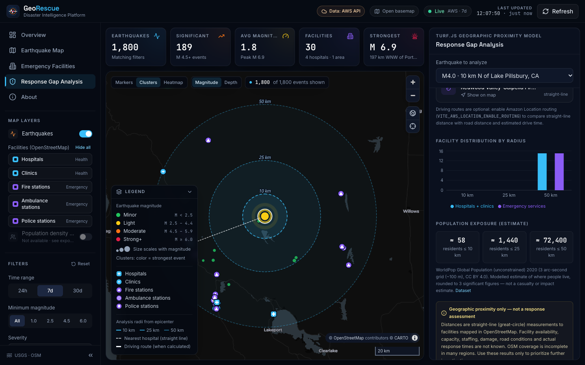
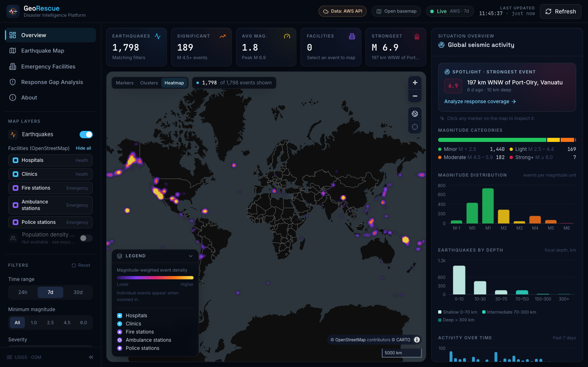
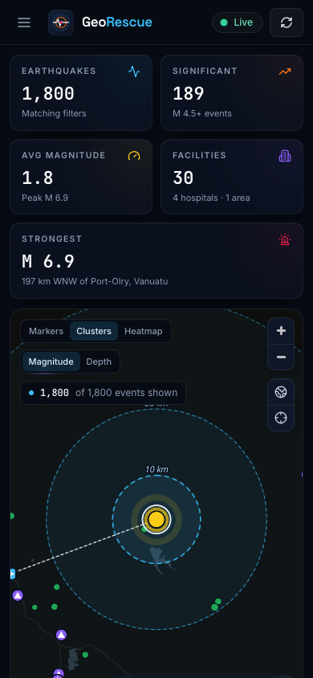
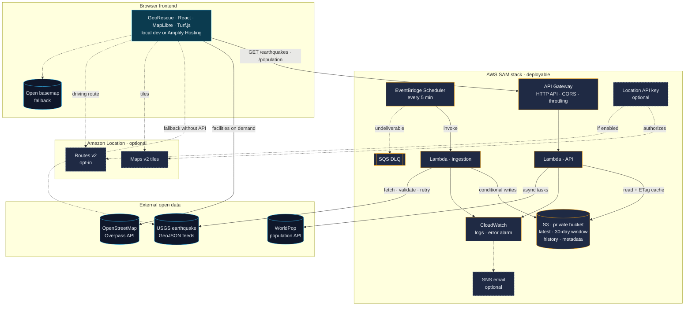

<div align="center">

# GeoRescue

### Mapping Disaster Impact and Emergency Response Gaps

**GeoRescue doesn't just show where earthquakes happen. It puts each earthquake next to the emergency infrastructure around it and the people who live there, so you can see where response coverage may be thin.**

React · TypeScript · MapLibre GL JS · Turf.js · AWS Lambda · Amazon S3 · API Gateway · EventBridge Scheduler · Amazon Location Service

[Features](#key-features) · [Methodology](#response-gap-analysis-methodology) · [Architecture](#architecture) · [Run locally](#local-setup) · [Deploy](#aws-deployment) · [Submission](docs/HACKATHON-SUBMISSION.md) · [Technical article](docs/ARTICLE.md)

</div>


---

## The problem

When a strong earthquake strikes, responders, analysts and planners need fast answers to practical questions:

- Where did it happen, and how strong and how deep was it?
- Which hospitals, clinics, fire stations, ambulance stations and police stations are nearby?
- How many people live within 10, 25 or 50 km?
- Is this a place where the nearest mapped hospital is dangerously far away?

The data to answer these questions is public, but it lives in separate places. Earthquake catalogs (USGS), infrastructure maps (OpenStreetMap) and population grids (WorldPop) each have their own formats and tools. Putting them together usually means GIS software, manual downloads and time that a fast-moving situation doesn't allow.

## Why GeoRescue matters

GeoRescue joins these three sources in one browser interface and computes, in seconds, **where geographic access to emergency infrastructure may be limited relative to the people exposed**. It is built for:

- **Triage of attention.** It highlights which of hundreds of daily events sit in poorly covered areas and deserve a closer look.
- **Transparency.** Every number comes from loaded data, with its source, method and limitations stated next to it.
- **Accessibility.** It works without accounts or GIS skills, and runs with zero configuration.

> GeoRescue supports decisions; it is not a dispatch or alerting system. It measures **geographic proximity**, not real response capability. See [Limitations](#known-limitations).

## Screenshots

| Intelligence brief for a selected event | Response gap analysis with configurable radii |
| --- | --- |
|  |  |
| **Population exposure (WorldPop)** | **Magnitude-weighted heatmap** |
|  |  |

<p align="center"></p>

## Key features

| Area | What you get |
| --- | --- |
| **Live earthquakes** | Real USGS events for the past 24 hours, 7 days or 30 days, refreshed every 5 minutes. Filter by minimum magnitude and severity band. |
| **Three map views** | Individual markers, clusters, or a magnitude-weighted heatmap. Color events by magnitude severity or by focal depth. |
| **Emergency infrastructure** | Hospitals, clinics, fire, ambulance and police stations from OpenStreetMap. Toggle each type, filter the list, and click any facility for its details. |
| **Response gap analysis** | Facility counts within three configurable radii, nearest hospital and fire station, a coverage class, and labeled rings on the map. |
| **Population exposure** | Estimated residents within each radius, from WorldPop's 2020 ~100 m population grid. |
| **Intelligence brief** | A copyable situation summary built deterministically from the calculated values (no LLM), with its limitations listed. |
| **Optional driving routes** | Road distance and drive-time estimates from a facility to the epicenter, via Amazon Location Routes v2. |
| **Overview analytics** | Magnitude categories and distribution, depth distribution, activity over time, most active regions (click to zoom), strongest events, and facility mix. |
| **Serverless data pipeline** | EventBridge → Lambda → S3 → Lambda → API Gateway, with a USGS fallback. The header always shows which source is active. |
| **Resilience** | Hedged requests across OpenStreetMap mirrors, local caching, retries, and an explicit loading, empty or error state for every data source. |

## Interactive map capabilities

- **Display modes.** Use *Markers* for every event, *Clusters* for low zoom levels (a cluster is colored by its strongest event, or by its mean depth), or *Heatmap* for magnitude-weighted density, with individual events fading in from zoom 6.
- **Color encoding.** Magnitude severity bands (green → red) or depth classes (shallow, intermediate, deep). All colors were checked for color-vision-deficiency separation and contrast on the dark map.
- **Selection.** Click an event to fly to it. A pulsing marker highlights the epicenter, dashed rings show each analysis radius, and a dotted line connects it to the nearest mapped hospital.
- **Facilities.** Each type has its own icon. Click one for a details card (operator, address, phone, beds, opening hours and website, shown only when OpenStreetMap actually has them) and its straight-line distance to the epicenter.
- **Navigation.** Use zoom-to-event and reset-view controls, click a region to zoom to it, and scan any zoomed-in area for facilities.
- **Legend.** It adapts to the active mode, color encoding, visible facility types and current radii.
- **Basemap.** Amazon Location Maps v2 when configured, otherwise an open CARTO/OpenStreetMap style. If an Amazon Location key is rejected, the app falls back automatically.

## Response gap analysis methodology

1. **Facility retrieval.** One Overpass query per epicenter fetches all mapped `amenity=hospital|clinic|fire_station|police`, `healthcare=hospital|clinic` and `emergency=ambulance_station` features within 50 km.
2. **Distances.** Turf.js computes the great-circle (straight-line) distance from the epicenter to each facility.
3. **Radii.** The user chooses three radii *r1 < r2 < r3 ≤ 50 km*: Urban 5/10/20, Standard 10/25/50 (the default), Rural 20/35/50, or custom values. GeoRescue counts each facility type within each radius. "Emergency services" means fire, ambulance and police stations.
4. **Nearest facilities.** It finds the nearest mapped hospital and nearest fire station.
5. **Coverage classification.** The class depends on the distance *d* to the nearest mapped hospital:

| Class | Condition | Standard preset |
| --- | --- | --- |
| Close hospital proximity | d ≤ r1 | ≤ 10 km |
| Moderate proximity | r1 < d ≤ r2 | 10–25 km |
| Limited proximity | r2 < d ≤ r3 | 25–50 km |
| Potential coverage gap | no mapped hospital within r3 | > 50 km |

This is a **geographic proximity assessment**. Facility availability, capacity, staffing, damage, road conditions and actual response times are unknown, and the interface says so wherever results appear. Optional Amazon Location routing adds road distance and estimated drive time for comparison. Straight-line distance is never labeled as travel distance or time.

## Population exposure methodology

- **Dataset.** [WorldPop](https://www.worldpop.org/) Global Population 2020, unconstrained, 3 arc-second grid (about 100 m at the equator), CC BY 4.0.
- **Calculation.** For each radius, the GeoRescue API builds a 48-vertex geodesic circle around the epicenter and submits it to WorldPop's zonal-statistics service, which sums the population cells inside it.
- **Why it goes through the API.** WorldPop's service sends no CORS headers (browsers can't call it), and its synchronous mode can take 20+ seconds. So the API Lambda starts WorldPop **async tasks** (`GET /population` returns `202` with task IDs), and the browser polls `GET /population/tasks` until results are ready. Results are cached in the Lambda and in the browser.
- **Presentation.** Values are rounded to 3 significant figures and labeled as **estimated residents**. They are not casualties, damage or real-time presence. An uninhabited area (for example, offshore) shows an exact 0.

Population exposure requires the GeoRescue API, either deployed or run locally with `npm run local`. Without it, the panel explains how to enable it.

## Architecture



**How to read the diagram.** Orange-bordered nodes are created by the SAM stack in [`infrastructure/template.yaml`](infrastructure/template.yaml). Dashed nodes and edges are optional or configuration-dependent. Blue cylinders are external public services. The stack is validated and ready to deploy. It has **not** been deployed by the author; see [docs/DEPLOYMENT.md](docs/DEPLOYMENT.md).

**Data flow.** Every 5 minutes, ingestion fetches the USGS `all_day` feed with retries and validates it, preserving the original USGS properties and coordinates. It merges the feed into a rolling 30-day window (seeded from `all_month` on the first run), writes `latest.geojson` and an hourly history snapshot that is never overwritten, and records ingestion metadata. S3 conditional writes make duplicate or overlapping runs safe. The API serves the window with filtering and gzip, plus `/health`, `/earthquakes/metadata` and the WorldPop population routes. Without the API, the browser reads USGS directly and shows a **USGS direct** or **USGS fallback** badge.

| Endpoint | Purpose |
| --- | --- |
| `GET /earthquakes?range=day\|week\|month&since=&minMagnitude=&limit=` | USGS-format GeoJSON from the rolling window (gzip) |
| `GET /earthquakes/metadata` | Last successful ingestion, last attempt, data age, staleness |
| `GET /health` | `200` when data is under 15 minutes old, otherwise `503` (`stale`, `no-data` or `error`) |
| `GET /population?lat=&lon=&radii=` | Starts WorldPop estimates (`202` with task IDs, or `200` if cached) |
| `GET /population/tasks?lat=&lon=&radii=&ids=` | Polls the tasks; `200` with residents per radius when complete |

## AWS services and why they were selected

| Service | Role | Why |
| --- | --- | --- |
| **Amazon EventBridge Scheduler** | Triggers ingestion every 5 minutes | Serverless cron with a retry policy and dead-letter queue; nothing runs between invocations |
| **AWS Lambda** (Node.js 24, arm64) | Ingestion, plus a read API with a population proxy | Pay-per-use compute; arm64 for better price-performance; no servers to patch |
| **Amazon S3** | Rolling 30-day GeoJSON window, latest feed, hourly history, metadata | Durable, cheap storage for read-mostly data rewritten every few minutes. Conditional writes give concurrency safety without a database |
| **Amazon API Gateway (HTTP API)** | Public HTTPS API | Built-in CORS allow-list, per-route throttling and access logs, at a lower price than REST APIs |
| **Amazon CloudWatch** | Structured JSON logs, an ingestion error alarm, API access logs | Operational visibility with bounded log retention |
| **Amazon SQS** | Dead-letter queue for undeliverable schedule events | Failed triggers are kept, not silently lost |
| **Amazon SNS** (optional) | Emails alarm state changes | Opt-in notification without extra infrastructure |
| **Amazon Location Service** (optional) | Maps v2 basemap tiles; Routes v2 driving routes | A browser-safe, referrer-restricted API key, so no backend is needed to render maps |
| **AWS Amplify Hosting** (optional) | Static hosting for the React build | Git-based CI/CD; build spec in [`amplify.yml`](amplify.yml) |

## Dataset sources and attribution

| Data | Source | License and terms | Notes |
| --- | --- | --- | --- |
| Earthquakes | [U.S. Geological Survey](https://earthquake.usgs.gov/earthquakes/feed/v1.0/geojson.php) GeoJSON summary feeds | Public domain (USGS) | Records missing a magnitude or coordinates are excluded, never estimated |
| Emergency facilities | [OpenStreetMap](https://www.openstreetmap.org/) via the [Overpass API](https://wiki.openstreetmap.org/wiki/Overpass_API) | © OpenStreetMap contributors, [ODbL](https://opendatacommons.org/licenses/odbl/) | Coverage varies by region |
| Population | [WorldPop](https://www.worldpop.org/) Global Population 2020 (unconstrained, ~100 m) | [CC BY 4.0](https://creativecommons.org/licenses/by/4.0/) | Modelled residential population |
| Basemap | Amazon Location Service (© AWS, HERE) or [CARTO](https://carto.com/attributions) Dark Matter | Provider terms | Attribution is shown on the map |
| Routing (optional) | Amazon Location Routes v2 | AWS service terms | Car mode, typical traffic |

## Technology stack

| Layer | Technologies |
| --- | --- |
| Frontend | React 18, TypeScript (strict), Vite 5, Tailwind CSS 3, Lucide icons |
| Mapping and GIS | MapLibre GL JS 6 (clustering, heatmap, symbol layers), Turf.js 7 (distances, geodesic circles) |
| Charts | Recharts 2 |
| Backend | AWS SAM, Lambda (Node.js 24, arm64), AWS SDK for JavaScript v3, esbuild |
| Quality | Vitest unit tests (frontend and Lambdas), cfn-lint via `sam validate --lint`; WCAG 2 A/AA audit with axe-core during development |

## Local setup

Prerequisites: **Node.js 20+** and npm.

```bash
git clone https://github.com/TanseerS/GeoRescue-Mapping-Disaster-Impact-and-Emergency-Response-Gaps.git
cd GeoRescue-Mapping-Disaster-Impact-and-Emergency-Response-Gaps
npm install
npm run dev          # http://localhost:5173 (live USGS + OpenStreetMap + open basemap, no configuration)
```

To run the **full pipeline locally, without AWS**, use the same ingestion and API code against live USGS and WorldPop, with an in-memory store:

```bash
cd infrastructure && npm install && npm run local          # API on http://localhost:3001
# in a second terminal, from the repository root:
VITE_API_BASE_URL=http://localhost:3001 npm run dev
```

| Command | Description |
| --- | --- |
| `npm run dev` / `npm run build` / `npm run preview` | Develop, build to `dist/`, or serve the build |
| `npm test` / `npm run typecheck` | Frontend unit tests and TypeScript check |
| `cd infrastructure && npm test` | Lambda unit tests |
| `cd infrastructure && sam validate --lint && sam build` | Validate and bundle the stack |

## Environment variables

Copy [`.env.example`](.env.example) to `.env.local`. Every variable is optional, and `VITE_*` values are public: **never put AWS credentials in them**.

| Variable | Purpose | Default |
| --- | --- | --- |
| `VITE_API_BASE_URL` | GeoRescue API URL (`ApiUrl` stack output, or `http://localhost:3001`). Enables the AWS data source and population exposure | *(empty → USGS direct)* |
| `VITE_API_FALLBACK_TO_USGS` | Fall back to the USGS feed if the API fails | `true` |
| `VITE_AWS_REGION` | Amazon Location region | `us-east-1` |
| `VITE_AWS_LOCATION_API_KEY` | Amazon Location API key (needs `geo-maps:GetTile`) | *(empty → open basemap)* |
| `VITE_AWS_LOCATION_MAP_STYLE` | `Standard`, `Monochrome`, `Hybrid` or `Satellite` | `Monochrome` |
| `VITE_AWS_LOCATION_COLOR_SCHEME` | `Dark` or `Light` | `Dark` |
| `VITE_AWS_LOCATION_ENABLE_ROUTING` | Driving routes (the key must also allow `geo-routes:CalculateRoutes`) | `false` |
| `VITE_FALLBACK_MAP_STYLE_URL` | MapLibre style used without Amazon Location | CARTO Dark Matter |
| `VITE_USGS_FEED_BASE_URL` | USGS summary feed base URL | USGS public feed |
| `VITE_OVERPASS_ENDPOINTS` | Comma-separated Overpass mirrors (hedged failover) | 3 public mirrors |

## AWS deployment

[**docs/DEPLOYMENT.md**](docs/DEPLOYMENT.md) has the full guide with exact commands. In short:

```bash
cd infrastructure
npm ci && npm test && sam validate --lint && sam build
sam deploy --guided                                     # set AllowedOrigins, CreateMapApiKey, MapAllowedReferers
aws lambda invoke --function-name <IngestFunctionName> --cli-binary-format raw-in-base64-out --payload '{}' response.json
curl "<ApiUrl>/health"
```

Then set `VITE_API_BASE_URL` (and, optionally, the Amazon Location key) for the frontend. Run it locally or connect the repository to **AWS Amplify Hosting**, which uses [`amplify.yml`](amplify.yml). Teardown is `sam delete`, plus emptying the retained data bucket. See [infrastructure/README.md](infrastructure/README.md) for the stack internals, API reference and CloudWatch queries.

## Security considerations

- **Least-privilege IAM.** The ingestion role can only `GetObject`/`PutObject` under `earthquakes/*` and `metadata/*`; the API role can only read them. Each function writes only to its own log group (SAM's broader default logging policy is replaced). The scheduler role can only invoke the ingestion function and write to its DLQ.
- **Private storage.** All four S3 Block Public Access settings are on, ACLs are disabled, SSE-S3 encrypts data at rest, and a bucket policy denies non-TLS requests. Browsers never access S3 directly.
- **API exposure.** Routes are GET-only, and CORS is limited to an explicit origin list. Stage throttling is 20 req/s with a burst of 50; the population routes are throttled tighter (1–5 req/s) because they call WorldPop.
- **Input validation.** Query parameters are range-checked (coordinates, radii, magnitudes, limits). WorldPop task IDs must match a UUID pattern before they reach an outbound URL. Error responses never include internal details; details go to CloudWatch.
- **Secrets.** There are no credentials in code, configuration or the bundle. Lambdas use execution roles. The only client-side credential is an Amazon Location API key, a browser-safe key restricted to specific actions, resources and referrers. `.env*` files are Git-ignored except `.env.example`.
- **Frontend.** All third-party text (USGS place names, OSM tags) is HTML-escaped in map popups or rendered as text by React. External links are limited to `http(s)` with `rel="noreferrer"`.
- **Dependencies.** `npm audit --omit=dev` reports **0 vulnerabilities** for both the frontend and the Lambda packages. MapLibre was upgraded to 6.14 and PostCSS to 8.5.30 to resolve advisories. Remaining advisories affect only local development tooling: the Vite 5 dev server and the Vitest 2 test runner. Fixing them requires major upgrades. They aren't part of the production bundle and only matter if the dev server or test UI is exposed to a network (both bind to localhost by default).

## Cost considerations

At a 5-minute schedule with demo traffic, the pipeline is estimated at **well under $1 per month**. Lambda (about 8,640 ingestion runs) and EventBridge Scheduler stay within their free tiers. S3 requests and storage, API Gateway ($1 per million requests) and CloudWatch Logs (14-day retention) cost cents. There are **no always-on resources**: no VPC, NAT Gateway or database. Amazon Location (per tile and route request) and Amplify Hosting (build minutes and data served) are billed separately if used. Set `IngestionScheduleState=DISABLED` to pause the pipeline. See the [cost breakdown](infrastructure/README.md#cost).

## Known limitations

- **Proximity is not response capability.** Straight-line distance ignores roads, terrain, damage, capacity, staffing and availability. Optional routing adds road estimates for typical traffic, not live emergency response times.
- **OpenStreetMap completeness varies.** The absence of a mapped facility doesn't prove that none exists.
- **Population figures are modelled 2020 estimates** of residents. They don't reflect current, daytime or displaced population, and they aren't impact estimates. There is no gridded population *map layer* (that would need raster tile hosting), so that toggle is disabled and labeled.
- **Public services can be slow.** Overpass mirrors and WorldPop sometimes take 5–60 s. GeoRescue hedges, retries and caches, and shows a clear retry state when a service fails.
- **Driving routes are optional and unverified against a live key here.** They require an Amazon Location key with routing permission; unit tests and a browser test against a mocked response cover the documented API format.
- **Not deployed by the author.** The AWS stack is validated (`sam validate --lint`, `sam build`) but not deployed. Without it, the app runs in direct-USGS mode, and population exposure needs the local or deployed API.
- **Earthquakes only.** Other hazards (floods, cyclones, wildfires) are not modelled yet.

## Future possibilities

- **More hazards.** GDACS and NASA FIRMS feeds for floods, cyclones and wildfires, using the same gap analysis.
- **Network-based accessibility.** Drive-time isochrones (Amazon Location isolines) instead of circular radii.
- **Gap ranking.** Batch analysis across all significant events, ranked by exposed population per nearest-hospital kilometre.
- **ShakeMap integration.** Weight exposure by USGS-estimated shaking intensity rather than distance alone.
- **Alerts and sharing.** Subscriptions for new events in watched regions, and shareable links that capture the map state.
- **Offline field mode.** Cached tiles and facility snapshots for low-connectivity deployments.

## Project structure

```
infrastructure/           AWS SAM stack: template.yaml, Lambda source, tests, local server
  src/functions/          Lambda entry points (ingest, api)
  src/ingest/             USGS client with retries and the ingestion workflow
  src/api/                Routing, validation, caching, gzip, WorldPop population proxy
  src/shared/             GeoJSON validation and merging, S3 storage, structured logging
src/
  components/             App shell (Header, Sidebar, StatsBar) and UI primitives
  config/                 Environment parsing and domain constants
  features/               analysis · earthquakes · facilities · intelligence · map · pipeline
  hooks/                  Feed, facilities, population, routing and persisted-settings hooks
  pages/                  Dashboard layout and About page
  services/               USGS, GeoRescue API, Overpass, WorldPop, routing and map-style clients
  utils/                  Geospatial analysis, statistics, intelligence brief, formatting
docs/                     Deployment guide, hackathon submission, demo script, screenshots
```

## License and attribution

Earthquake data courtesy of the U.S. Geological Survey. Facility data © OpenStreetMap contributors (ODbL). Population data © WorldPop (CC BY 4.0). Basemap © CARTO / OpenStreetMap contributors, or © AWS / HERE when using Amazon Location Service.
