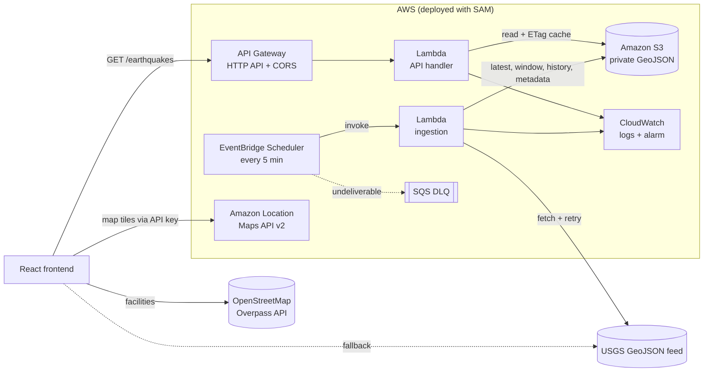

# GeoRescue – Mapping Disaster Impact and Emergency Response Gaps

**GeoRescue** is a disaster intelligence platform that maps live earthquakes alongside nearby hospitals and emergency facilities, so you can see where seismic activity is happening and which affected areas may have limited access to emergency infrastructure.

Built for the **AWS Builder Weekend Challenge**.


## What it does

- **Live earthquake map.** Real USGS events for the past 24 hours, 7 days or 30 days. Markers are clustered, sized by magnitude and colored by severity. The feed refreshes automatically every 5 minutes.
- **Event inspection.** Click any marker to see magnitude, location, depth, local/UTC time, coordinates, USGS tsunami and PAGER flags, and the nearest mapped facilities with distances.
- **Emergency facilities.** Hospitals, fire stations, police and ambulance stations come from OpenStreetMap (Overpass API). You can load them around a selected epicenter or scan the visible map area.
- **Response gap analysis.** Turf.js counts hospitals within 10, 25 and 50 km, finds the nearest mapped hospital, and rates proximity from *hospital within 10 km* to *no mapped hospital within 50 km*.
- **Situation overview.** Statistics, magnitude distribution, activity timeline, most active regions and strongest events. Everything is computed from the data that's actually loaded.
- **AWS serverless data pipeline.** EventBridge Scheduler runs a Lambda every 5 minutes that ingests the USGS feed into Amazon S3. A second Lambda serves it through API Gateway. The header shows whether data comes from the **AWS API**, **USGS directly**, or a **USGS fallback** when the API is unreachable.
- **Amazon Location Service basemap.** This is configurable through environment variables. If AWS isn't configured, or the key is rejected, the app falls back to an open basemap automatically.

| Earthquake details | Response gap analysis |
| --- | --- |
|  |  |

## Tech stack

**Frontend:** React 18 · TypeScript · Vite 5 · Tailwind CSS 3 · MapLibre GL JS 6 · Turf.js 7 · Recharts 2 · Lucide icons · Vitest

**AWS:** AWS SAM · Lambda (Node.js 24, arm64) · Amazon S3 · EventBridge Scheduler · API Gateway HTTP API · CloudWatch · Amazon Location Service

## AWS architecture



| Service | Why it is used |
| --- | --- |
| **EventBridge Scheduler** | Serverless cron that triggers ingestion every 5 minutes, with a retry policy and a dead-letter queue. Nothing runs between triggers. |
| **AWS Lambda** | Ingestion (fetch, validate, normalize, store) and a lightweight read API. Pay per invocation; arm64 for better price-performance. |
| **Amazon S3** | Durable, cheap storage for GeoJSON snapshots, a rolling 30-day window and ingestion metadata. No database is needed for read-mostly data that is rewritten every 5 minutes. |
| **API Gateway (HTTP API)** | Public HTTPS endpoint with built-in CORS and throttling, at about a third of the cost of REST APIs. |
| **CloudWatch** | Structured JSON logs, an ingestion error alarm (optionally emailed via SNS), and API access logs. |
| **Amazon Location Service** | Map tiles via a browser-safe, referrer-restricted API key. No backend is needed to render the map. |

Ingestion fetches the USGS `all_day` feed with retries, validates it, and keeps the original USGS properties and coordinates. It writes `earthquakes/latest.geojson`, merges the feed into `earthquakes/window-30d.geojson` (seeded from `all_month` on the first run), stores an hourly snapshot under `earthquakes/history/YYYY/MM/DD/HH.json` that is never overwritten, and records `metadata/latest.json`. Repeat or overlapping runs are skipped or reconciled through S3 conditional writes, so stored data can't be corrupted. Full details, including deployment, IAM and the cost breakdown, are in **[infrastructure/README.md](infrastructure/README.md)**.

### API endpoints

| Endpoint | Description |
| --- | --- |
| `GET /earthquakes?range=day\|week\|month&since=&minMagnitude=&limit=` | USGS-format GeoJSON `FeatureCollection` from the rolling window (gzip-compressed) |
| `GET /earthquakes/metadata` | Last successful ingestion, last attempt, data age and staleness |
| `GET /health` | `200` when data is fresh (under 15 minutes old), otherwise `503` with `stale`, `no-data` or `error` |

### Deploying the AWS pipeline

Prerequisites: an AWS account, AWS CLI v2 with credentials, AWS SAM CLI and Node.js 20+.

```bash
cd infrastructure
npm install && npm test
sam validate --lint
sam build
sam deploy --guided            # set AllowedOrigins to your frontend URL(s)
sam list stack-outputs --stack-name georescue
```

Copy the `ApiUrl` output into the frontend's `.env.local` as `VITE_API_BASE_URL`, then restart `npm run dev`. To run the first ingestion immediately, run `aws lambda invoke --function-name <IngestFunctionName> response.json`.

### Security and cost at a glance

- **Least-privilege IAM.** The ingestion role can read and write only `earthquakes/*` and `metadata/*`; the API role can only read them. Each function writes only to its own log group, and the scheduler can only invoke the ingestion function.
- **Private bucket.** Block Public Access, SSE-S3 encryption, TLS-only access and no ACLs. The browser never touches S3.
- **API controls.** CORS is limited to configured origins, routes are GET-only, the stage is throttled, and errors never expose internal details.
- **Credentials.** None are embedded anywhere. Lambdas use execution roles; the map key is a restricted, browser-safe Amazon Location key.
- **No always-on resources.** There is no VPC, NAT Gateway or database. The pipeline typically costs **well under $1 per month** at demo traffic, and Lambda and Scheduler usage fits within their free tiers (see the [cost breakdown](infrastructure/README.md#cost)).

## Getting started

Prerequisites: **Node.js 20+** and npm.

```bash
git clone https://github.com/TanseerS/GeoRescue-Mapping-Disaster-Impact-and-Emergency-Response-Gaps.git
cd GeoRescue-Mapping-Disaster-Impact-and-Emergency-Response-Gaps
npm install
npm run dev
```

Open the URL Vite prints (default `http://localhost:5173`). No configuration is needed: the app runs with live USGS data, OpenStreetMap facilities and an open basemap.

### Local development without AWS

There are two options:

- **Direct mode (default).** Leave `VITE_API_BASE_URL` empty and the browser reads USGS directly.
- **Local pipeline.** Run the real ingestion and API code against live USGS data, using an in-memory store:

  ```bash
  cd infrastructure && npm install && npm run local     # API on http://localhost:3001
  # in another terminal, from the repository root:
  VITE_API_BASE_URL=http://localhost:3001 npm run dev
  ```

### Scripts

| Command | Description |
| --- | --- |
| `npm run dev` | Start the development server |
| `npm run build` | Type-check and build for production into `dist/` |
| `npm run preview` | Serve the production build locally |
| `npm run typecheck` | Run the TypeScript compiler only |
| `npm test` | Run the frontend unit tests (Vitest) |
| `cd infrastructure && npm test` | Run the Lambda unit tests |

## Configuration

Copy `.env.example` to `.env.local` and fill in what you need. Every variable is optional.

| Variable | Purpose | Default |
| --- | --- | --- |
| `VITE_API_BASE_URL` | GeoRescue AWS API URL (`ApiUrl` stack output). When set, earthquakes load from the AWS pipeline | *(empty → USGS direct)* |
| `VITE_API_FALLBACK_TO_USGS` | Fall back to the direct USGS feed if the AWS API fails | `true` |
| `VITE_AWS_REGION` | Amazon Location Service region | `us-east-1` |
| `VITE_AWS_LOCATION_API_KEY` | Amazon Location API key. Enables the AWS basemap | *(empty → open basemap)* |
| `VITE_AWS_LOCATION_MAP_STYLE` | `Standard`, `Monochrome`, `Hybrid` or `Satellite` | `Monochrome` |
| `VITE_AWS_LOCATION_COLOR_SCHEME` | `Dark` or `Light` (Standard/Monochrome only) | `Dark` |
| `VITE_FALLBACK_MAP_STYLE_URL` | Any MapLibre style URL used when AWS is unavailable | CARTO Dark Matter |
| `VITE_USGS_FEED_BASE_URL` | USGS summary feed base URL | USGS public feed |
| `VITE_OVERPASS_ENDPOINTS` | Comma-separated Overpass API mirrors, tried with failover | 3 public mirrors |

### Enabling Amazon Location Service

You can create the key in either of two ways:

- **With the SAM stack.** Deploy with `CreateMapApiKey=true` and `MapAllowedReferers="http://localhost:5173/*,https://your-domain/*"`, then read the key with `aws location describe-key --key-name georescue-maps --query Key --output text`.
- **In the console.** In the [Amazon Location console](https://console.aws.amazon.com/location/), go to **API keys** and create a key that allows only the action **`geo-maps:GetTile`** on resource `arn:aws:geo-maps:<region>::provider/default`. Style descriptors, sprites and glyphs don't require authorization, so tiles are the only call the key needs. Restrict it with **referrers** for your app's URLs, such as `http://localhost:5173/*` and your production domain.

Then set `VITE_AWS_LOCATION_API_KEY` and `VITE_AWS_REGION` in `.env.local` and restart `npm run dev`. Invalid style, color scheme or region values fall back to safe defaults with a console warning. Tile requests are guaranteed to carry the key.

The header badge and the **About** page show which basemap is active. The app uses the Amazon Location **Maps API v2** style descriptor (`https://maps.geo.{region}.amazonaws.com/v2/styles/{style}/descriptor`). The API key is the only credential, and it is a browser-safe key designed for this purpose. **Never put AWS access keys or secrets in `VITE_*` variables**, because they are embedded in the client bundle.

## Data sources and methodology

| Data | Source | Notes |
| --- | --- | --- |
| Earthquakes | [USGS GeoJSON summary feeds](https://earthquake.usgs.gov/earthquakes/feed/v1.0/geojson.php) (`all_day`, `all_week`, `all_month`), either directly or through the GeoRescue AWS API | Records without magnitude or coordinates are excluded, never estimated |
| Facilities | [OpenStreetMap](https://www.openstreetmap.org/) via the [Overpass API](https://wiki.openstreetmap.org/wiki/Overpass_API) | `amenity=hospital\|fire_station\|police`, `healthcare=hospital`, `emergency=ambulance_station` |
| Basemap | Amazon Location Service, or CARTO / OpenStreetMap as the fallback | |

- **Severity bands** follow USGS feed thresholds: Minor < 2.5, Light 2.5–4.4, Moderate 4.5–5.9, Strong+ ≥ 6.0.
- **Significant earthquakes** are events of magnitude 4.5 or higher.
- **Gap analysis** uses Turf.js great-circle distances from the epicenter to each mapped facility within 50 km.
- **Facility lookups are resilient.** Requests are hedged across Overpass mirrors: the next mirror starts if one is slow or fails, and the first success wins. Real responses are cached in `localStorage` for 24 hours, so revisited areas load instantly. If every mirror fails, the UI shows a retry state. No facility data is ever fabricated.

> **Proximity is an estimate.** Straight-line distance does not account for roads, terrain, travel time, damage, facility capacity, staffing or real-time availability. OpenStreetMap coverage varies by region, so a missing facility does not prove none exists. GeoRescue supports prioritizing further investigation. It is not an emergency dispatch or alerting system.

## Project structure

```
infrastructure/      AWS SAM stack: template.yaml, Lambda source, tests, local server
  src/functions/     Lambda entry points (ingest, api)
  src/ingest/        USGS client with retries and the ingestion workflow
  src/api/           API routing, validation, caching and gzip responses
  src/shared/        GeoJSON validation and merging, S3 storage, logging
src/
  components/        App shell (Header, Sidebar, StatsBar) and UI primitives
  config/            Environment parsing and domain constants
  features/
    analysis/        Response gap analysis panel
    earthquakes/     Details, list and overview insights
    facilities/      Facility panel, list and loading/error states
    map/             MapLibre view, layers, icons, legend and overlays
  hooks/             Data hooks (USGS feed, facility store, timers)
  pages/             Dashboard layout and About page
  services/          USGS, AWS API, Overpass, facility cache and map style clients
  types/             Shared TypeScript types
  utils/             Geospatial analysis, statistics, formatting
```

Data fetching (`services/`, `hooks/`), map logic (`features/map/`), calculations (`utils/`) and presentation (`components/`, `features/`) are kept separate. The pure logic is covered by unit tests in `src/**/*.test.ts`.

## Known limitations

- Population density is not shown, because no openly licensed dataset is connected yet. Its layer toggle is disabled and labeled to say so.
- Public Overpass servers can be slow under load. A dense metro area may take 30–60 seconds the first time; after that it loads from the local cache.
- Without `VITE_API_BASE_URL`, the app reads USGS directly from the browser. OpenStreetMap facilities are always fetched from the browser, because Overpass queries are per-location and on demand.
- Until the first ingestion completes after deployment (up to 5 minutes, or run it manually), the API returns `503` and the app falls back to USGS.
- The full 30-day response depends on gzip to stay under Lambda's 6 MB response limit. Browsers always request gzip; for other clients, use `range` or `minMagnitude` to narrow the response.

## License

Earthquake data courtesy of the U.S. Geological Survey. Facility data © OpenStreetMap contributors (ODbL). Basemap © CARTO / OpenStreetMap contributors, or © AWS / HERE when using Amazon Location Service.
