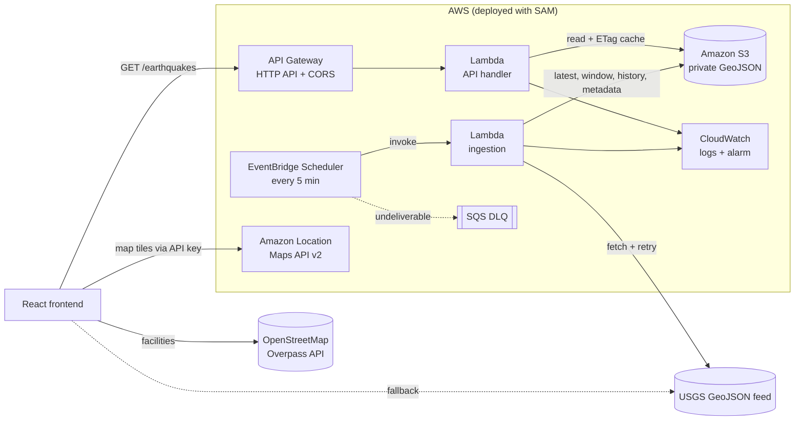

# GeoRescue – Mapping Disaster Impact and Emergency Response Gaps

**GeoRescue** is a disaster intelligence platform that maps live earthquakes alongside nearby hospitals and emergency facilities, so you can see where seismic activity is happening and which affected areas may have limited access to emergency infrastructure.

Built for the **AWS Builder Weekend Challenge**.


## What it does

- **Earthquake intelligence.** Live USGS events for the past 24 hours, 7 days or 30 days. You can switch between **individual markers**, **clusters** and a **magnitude-weighted heatmap**, and color events by **magnitude severity** or **focal depth**. Everything updates as soon as filters change.
- **Emergency infrastructure.** Hospitals, clinics, fire stations, ambulance stations and police stations come from OpenStreetMap. Each type can be toggled and filtered separately. Click a facility to see its OSM details (only tags that exist) and its distance from the selected epicenter.
- **Response gap analysis.** Pick configurable analysis radii (Urban 5/10/20, Standard 10/25/50, Rural 20/35/50, or custom). GeoRescue then counts every facility type within each radius, finds the nearest hospital and fire station, draws labeled rings on the map, and assigns a coverage class.
- **Population exposure.** Estimated residents within each radius, from WorldPop's 2020 ~100 m gridded population dataset, served through the GeoRescue AWS API. These are clearly labeled as estimates, not casualty figures.
- **Driving routes (optional).** Amazon Location Routes v2 calculates road distance and estimated drive time from a facility to the epicenter. Without it, the app shows straight-line distance only and never labels it as travel distance or time.
- **Intelligence brief.** A deterministic, copyable summary of the selected event, built only from calculated values (no LLM), with its limitations stated.
- **Overview analytics.** Magnitude categories, magnitude and depth distributions, activity over time, most active regions (click one to zoom the map there), the strongest events, and mapped facilities by type.
- **AWS serverless data pipeline.** EventBridge Scheduler runs a Lambda every 5 minutes that ingests the USGS feed into Amazon S3. A second Lambda serves it through API Gateway. The header shows whether data comes from the **AWS API**, **USGS directly**, or a **USGS fallback**.
- **Amazon Location Service basemap.** This is configurable through environment variables. If AWS isn't configured, or the key is rejected, the app falls back to an open basemap automatically.

| Intelligence brief | Response gap analysis | Magnitude-weighted heatmap |
| --- | --- | --- |
|  |  |  |

## Tech stack

**Frontend:** React 18 · TypeScript · Vite 5 · Tailwind CSS 3 · MapLibre GL JS 6 · Turf.js 7 · Recharts 2 · Lucide icons · Vitest

**AWS:** AWS SAM · Lambda (Node.js 24, arm64) · Amazon S3 · EventBridge Scheduler · API Gateway HTTP API · CloudWatch · Amazon Location Service

## AWS architecture



| Service | Why it is used |
| --- | --- |
| **EventBridge Scheduler** | Serverless cron that triggers ingestion every 5 minutes, with a retry policy and a dead-letter queue. Nothing runs between triggers. |
| **AWS Lambda** | Ingestion (fetch, validate, normalize, store) and a lightweight read API. Pay per invocation; arm64 for better price-performance. |
| **Amazon S3** | Durable, cheap storage for GeoJSON snapshots, a rolling 30-day window and ingestion metadata. No database is needed for read-mostly data that is rewritten every 5 minutes. |
| **API Gateway (HTTP API)** | Public HTTPS endpoint with built-in CORS and throttling, at about a third of the cost of REST APIs. |
| **CloudWatch** | Structured JSON logs, an ingestion error alarm (optionally emailed via SNS), and API access logs. |
| **Amazon Location Service** | Map tiles via a browser-safe, referrer-restricted API key. No backend is needed to render the map. |

Ingestion fetches the USGS `all_day` feed with retries, validates it, and keeps the original USGS properties and coordinates. It writes `earthquakes/latest.geojson`, merges the feed into `earthquakes/window-30d.geojson` (seeded from `all_month` on the first run), stores an hourly snapshot under `earthquakes/history/YYYY/MM/DD/HH.json` that is never overwritten, and records `metadata/latest.json`. Repeat or overlapping runs are skipped or reconciled through S3 conditional writes, so stored data can't be corrupted. Full details, including deployment, IAM and the cost breakdown, are in **[infrastructure/README.md](infrastructure/README.md)**.

### API endpoints

| Endpoint | Description |
| --- | --- |
| `GET /earthquakes?range=day\|week\|month&since=&minMagnitude=&limit=` | USGS-format GeoJSON `FeatureCollection` from the rolling window (gzip-compressed) |
| `GET /earthquakes/metadata` | Last successful ingestion, last attempt, data age and staleness |
| `GET /health` | `200` when data is fresh (under 15 minutes old), otherwise `503` with `stale`, `no-data` or `error` |
| `GET /population?lat=&lon=&radii=` | Starts WorldPop population estimates and returns `202` with task IDs (or `200` if cached) |
| `GET /population/tasks?lat=&lon=&radii=&ids=` | Polls those tasks; returns `200` with residents per radius when complete |

### Deploying the AWS pipeline

Prerequisites: an AWS account, AWS CLI v2 with credentials, AWS SAM CLI and Node.js 20+.

```bash
cd infrastructure
npm install && npm test
sam validate --lint
sam build
sam deploy --guided            # set AllowedOrigins to your frontend URL(s)
sam list stack-outputs --stack-name georescue
```

Copy the `ApiUrl` output into the frontend's `.env.local` as `VITE_API_BASE_URL`, then restart `npm run dev`. To run the first ingestion immediately, run `aws lambda invoke --function-name <IngestFunctionName> response.json`.

### Security and cost at a glance

- **Least-privilege IAM.** The ingestion role can read and write only `earthquakes/*` and `metadata/*`; the API role can only read them. Each function writes only to its own log group, and the scheduler can only invoke the ingestion function.
- **Private bucket.** Block Public Access, SSE-S3 encryption, TLS-only access and no ACLs. The browser never touches S3.
- **API controls.** CORS is limited to configured origins, routes are GET-only, the stage is throttled, and errors never expose internal details.
- **Credentials.** None are embedded anywhere. Lambdas use execution roles; the map key is a restricted, browser-safe Amazon Location key.
- **No always-on resources.** There is no VPC, NAT Gateway or database. The pipeline typically costs **well under $1 per month** at demo traffic, and Lambda and Scheduler usage fits within their free tiers (see the [cost breakdown](infrastructure/README.md#cost)).

## Getting started

Prerequisites: **Node.js 20+** and npm.

```bash
git clone https://github.com/TanseerS/GeoRescue-Mapping-Disaster-Impact-and-Emergency-Response-Gaps.git
cd GeoRescue-Mapping-Disaster-Impact-and-Emergency-Response-Gaps
npm install
npm run dev
```

Open the URL Vite prints (default `http://localhost:5173`). No configuration is needed: the app runs with live USGS data, OpenStreetMap facilities and an open basemap.

### Local development without AWS

There are two options:

- **Direct mode (default).** Leave `VITE_API_BASE_URL` empty and the browser reads USGS directly.
- **Local pipeline.** Run the real ingestion and API code against live USGS data, using an in-memory store:

  ```bash
  cd infrastructure && npm install && npm run local     # API on http://localhost:3001
  # in another terminal, from the repository root:
  VITE_API_BASE_URL=http://localhost:3001 npm run dev
  ```

### Scripts

| Command | Description |
| --- | --- |
| `npm run dev` | Start the development server |
| `npm run build` | Type-check and build for production into `dist/` |
| `npm run preview` | Serve the production build locally |
| `npm run typecheck` | Run the TypeScript compiler only |
| `npm test` | Run the frontend unit tests (Vitest) |
| `cd infrastructure && npm test` | Run the Lambda unit tests |

## Configuration

Copy `.env.example` to `.env.local` and fill in what you need. Every variable is optional.

| Variable | Purpose | Default |
| --- | --- | --- |
| `VITE_API_BASE_URL` | GeoRescue AWS API URL (`ApiUrl` stack output). When set, earthquakes load from the AWS pipeline | *(empty → USGS direct)* |
| `VITE_API_FALLBACK_TO_USGS` | Fall back to the direct USGS feed if the AWS API fails | `true` |
| `VITE_AWS_REGION` | Amazon Location Service region | `us-east-1` |
| `VITE_AWS_LOCATION_API_KEY` | Amazon Location API key. Enables the AWS basemap | *(empty → open basemap)* |
| `VITE_AWS_LOCATION_MAP_STYLE` | `Standard`, `Monochrome`, `Hybrid` or `Satellite` | `Monochrome` |
| `VITE_AWS_LOCATION_COLOR_SCHEME` | `Dark` or `Light` (Standard/Monochrome only) | `Dark` |
| `VITE_AWS_LOCATION_ENABLE_ROUTING` | Enable driving routes (the key must allow `geo-routes:CalculateRoutes`) | `false` |
| `VITE_FALLBACK_MAP_STYLE_URL` | Any MapLibre style URL used when AWS is unavailable | CARTO Dark Matter |
| `VITE_USGS_FEED_BASE_URL` | USGS summary feed base URL | USGS public feed |
| `VITE_OVERPASS_ENDPOINTS` | Comma-separated Overpass API mirrors, tried with failover | 3 public mirrors |

### Enabling Amazon Location Service

You can create the key in either of two ways:

- **With the SAM stack.** Deploy with `CreateMapApiKey=true` and `MapAllowedReferers="http://localhost:5173/*,https://your-domain/*"`, then read the key with `aws location describe-key --key-name georescue-maps --query Key --output text`.
- **In the console.** In the [Amazon Location console](https://console.aws.amazon.com/location/), go to **API keys** and create a key that allows only the action **`geo-maps:GetTile`** on resource `arn:aws:geo-maps:<region>::provider/default`. Style descriptors, sprites and glyphs don't require authorization, so tiles are the only call the key needs. Restrict it with **referrers** for your app's URLs, such as `http://localhost:5173/*` and your production domain.

Then set `VITE_AWS_LOCATION_API_KEY` and `VITE_AWS_REGION` in `.env.local` and restart `npm run dev`.

### Enabling driving routes (optional)

Routing uses the [Amazon Location Routes API v2](https://docs.aws.amazon.com/location/latest/developerguide/calculate-routes-origin-destination-waypoints.html) (`POST https://routes.geo.<region>.amazonaws.com/v2/routes?key=…`, `TravelMode: Car`) with the same browser API key.

1. Allow **`geo-routes:CalculateRoutes`** on `arn:aws:geo-routes:<region>::provider/default` for the key. With SAM, deploy with `CreateMapApiKey=true EnableMapRouting=true`.
2. Set `VITE_AWS_LOCATION_ENABLE_ROUTING=true` and restart the dev server.
3. Click a facility (or use the nearest-hospital and nearest-fire-station cards in Response Gap Analysis), then choose **Driving route to epicenter**. The route is drawn on the map, with road distance and estimated duration.

The duration is Amazon Location's estimate for typical traffic. It is not a live emergency response time. Offshore or off-network epicenters return a clear "no drivable route" message. Routing is unit-tested against the documented request and response format, but it hasn't been exercised against a live key in this repository. Invalid style, color scheme or region values fall back to safe defaults with a console warning. Tile requests are guaranteed to carry the key.

The header badge and the **About** page show which basemap is active. The app uses the Amazon Location **Maps API v2** style descriptor (`https://maps.geo.{region}.amazonaws.com/v2/styles/{style}/descriptor`). The API key is the only credential, and it is a browser-safe key designed for this purpose. **Never put AWS access keys or secrets in `VITE_*` variables**, because they are embedded in the client bundle.

## Data sources and methodology

| Data | Source | Notes |
| --- | --- | --- |
| Earthquakes | [USGS GeoJSON summary feeds](https://earthquake.usgs.gov/earthquakes/feed/v1.0/geojson.php) (`all_day`, `all_week`, `all_month`), either directly or through the GeoRescue AWS API | Records without magnitude or coordinates are excluded, never estimated |
| Facilities | [OpenStreetMap](https://www.openstreetmap.org/) via the [Overpass API](https://wiki.openstreetmap.org/wiki/Overpass_API) | `amenity=hospital\|fire_station\|police`, `healthcare=hospital`, `emergency=ambulance_station` |
| Population | [WorldPop](https://www.worldpop.org/) Global Population 2020, unconstrained, 3 arc-seconds (~100 m), via the WorldPop stats API and the GeoRescue AWS API | CC BY 4.0. Modelled residential population, rounded to 3 significant figures |
| Driving routes | Amazon Location Routes API v2 (optional) | Car travel mode, typical traffic |
| Basemap | Amazon Location Service, or CARTO / OpenStreetMap as the fallback | |

- **Severity bands** follow USGS feed thresholds: Minor < 2.5, Light 2.5–4.4, Moderate 4.5–5.9, Strong+ ≥ 6.0.
- **Significant earthquakes** are events of magnitude 4.5 or higher.
- **Depth classes** follow standard seismological focal-depth classes: shallow 0–70 km, intermediate 70–300 km, deep > 300 km. The depth chart bins events at 10/30/70/150/300 km.
- **Heatmap** is a magnitude-weighted kernel density: each event's weight rises from 0.04 at M0 to 1.0 at M6+. Large events dominate, and swarms of micro-quakes don't drown them out. Individual events fade in from zoom 6.
- **Clusters** are colored by the strongest event in the cluster, or by mean depth in depth mode.
- **Facility search.** One Overpass query per epicenter fetches all five facility types within 50 km (the maximum analysis radius).
- **Gap analysis.** Turf.js computes the great-circle distance from the epicenter to every mapped facility. GeoRescue counts each type within the three analysis radii and finds the nearest facility of each type. "Emergency services" means fire, ambulance and police stations.
- **Coverage classification** is based on the straight-line distance to the nearest *mapped* hospital, compared with the configured radii *r1 < r2 < r3*:

  | Class | Rule (Standard preset) |
  | --- | --- |
  | Close hospital proximity | nearest hospital ≤ r1 (10 km) |
  | Moderate proximity | r1 < distance ≤ r2 (10–25 km) |
  | Limited proximity | r2 < distance ≤ r3 (25–50 km) |
  | Potential coverage gap | no mapped hospital within r3 (50 km) |

- **Population exposure.** For each radius, the API submits a geodesic circle polygon (48 vertices) to WorldPop's zonal statistics service, which sums the population grid cells inside it. Results are rounded to 3 significant figures in the UI.
- **Intelligence brief.** Sentences are assembled deterministically from the values above. If a value is missing (for example, facilities failed to load), the brief says so instead of guessing.
- **Facility lookups are resilient.** Requests are hedged across Overpass mirrors: the next mirror starts if one is slow or fails, and the first success wins. Real responses are cached in `localStorage` for 24 hours, so revisited areas load instantly. If every mirror fails, the UI shows a retry state. No facility data is ever fabricated.

> **Population figures are estimates of where people live.** WorldPop is a modelled 2020 dataset. It does not reflect current population, time-of-day presence or displacement, and it says nothing about casualties or damage.

> **Proximity is an estimate.** Straight-line distance does not account for roads, terrain, travel time, damage, facility capacity, staffing or real-time availability. OpenStreetMap coverage varies by region, so a missing facility does not prove none exists. GeoRescue supports prioritizing further investigation. It is not an emergency dispatch or alerting system.

## Project structure

```
infrastructure/      AWS SAM stack: template.yaml, Lambda source, tests, local server
  src/functions/     Lambda entry points (ingest, api)
  src/ingest/        USGS client with retries and the ingestion workflow
  src/api/           API routing, validation, caching and gzip responses
  src/shared/        GeoJSON validation and merging, S3 storage, logging
src/
  components/        App shell (Header, Sidebar, StatsBar) and UI primitives
  config/            Environment parsing and domain constants
  features/
    analysis/        Response gap analysis, radius controls, population exposure
    intelligence/    Deterministic intelligence brief
    earthquakes/     Details, list and overview insights
    facilities/      Facility panel, list and loading/error states
    map/             MapLibre view, display modes, layers, icons, legend and overlays
    pipeline/        AWS pipeline status card
  hooks/             Data hooks (feed, facilities, population, routing, persisted settings)
  pages/             Dashboard layout and About page
  services/          USGS, AWS API, Overpass, WorldPop, routing and map style clients
  types/             Shared TypeScript types
  utils/             Geospatial analysis, statistics, intelligence brief, formatting
```

Data fetching (`services/`, `hooks/`), map logic (`features/map/`), calculations (`utils/`) and presentation (`components/`, `features/`) are kept separate. The pure logic is covered by unit tests in `src/**/*.test.ts`.

## Known limitations

- **Population.** Exposure estimates per radius require the GeoRescue API (deployed, or `npm run local`). Without it, the app explains how to enable them. A gridded population *map layer* isn't included (it would need raster tile hosting), so that toggle stays disabled and labeled. WorldPop's service is free but can be slow (5–25 s per task), so results are cached.
- **Routing** is optional and requires an Amazon Location key with routing permission. It isn't verified against a live key here; unit tests cover the documented API format.
- Public Overpass servers can be slow under load. A dense metro area may take 30–60 seconds the first time; after that it loads from the local cache.
- Without `VITE_API_BASE_URL`, the app reads USGS directly from the browser. OpenStreetMap facilities are always fetched from the browser, because Overpass queries are per-location and on demand.
- Until the first ingestion completes after deployment (up to 5 minutes, or run it manually), the API returns `503` and the app falls back to USGS.
- The full 30-day response depends on gzip to stay under Lambda's 6 MB response limit. Browsers always request gzip; for other clients, use `range` or `minMagnitude` to narrow the response.

## License

Earthquake data courtesy of the U.S. Geological Survey. Facility data © OpenStreetMap contributors (ODbL). Basemap © CARTO / OpenStreetMap contributors, or © AWS / HERE when using Amazon Location Service.
