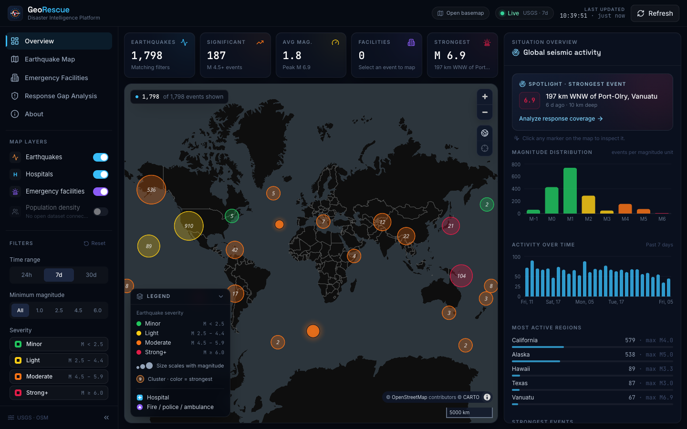
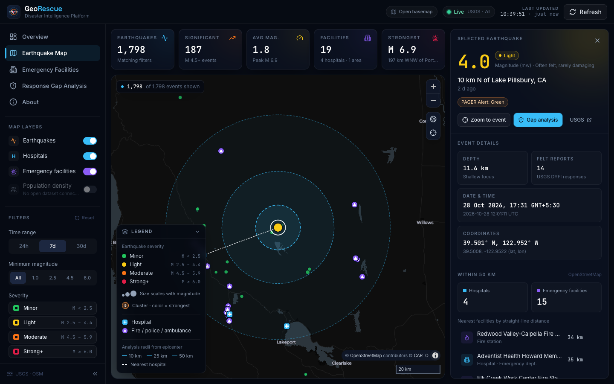
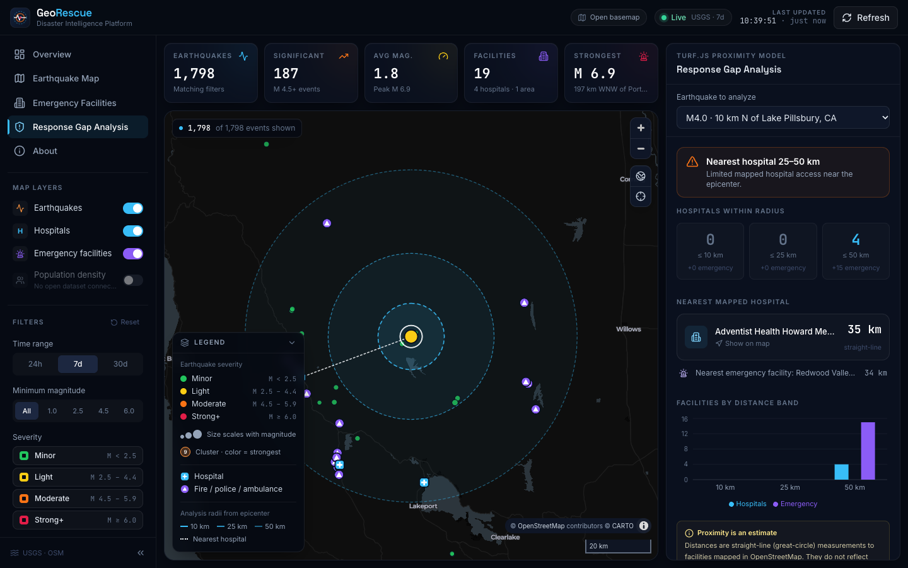

# GeoRescue – Mapping Disaster Impact and Emergency Response Gaps

**GeoRescue** is a disaster intelligence platform that maps live earthquakes alongside nearby hospitals and emergency facilities, so you can see where seismic activity is happening and which affected areas may have limited access to emergency infrastructure.

Built for the **AWS Builder Weekend Challenge**.



## What it does

- **Live earthquake map.** Real USGS events for the past 24 hours, 7 days or 30 days. Markers are clustered, sized by magnitude and colored by severity. The feed refreshes automatically every 5 minutes.
- **Event inspection.** Click any marker to see magnitude, location, depth, local/UTC time, coordinates, USGS tsunami and PAGER flags, and the nearest mapped facilities with distances.
- **Emergency facilities.** Hospitals, fire stations, police and ambulance stations come from OpenStreetMap (Overpass API). You can load them around a selected epicenter or scan the visible map area.
- **Response gap analysis.** Turf.js counts hospitals within 10, 25 and 50 km, finds the nearest mapped hospital, and rates proximity from *hospital within 10 km* to *no mapped hospital within 50 km*.
- **Situation overview.** Statistics, magnitude distribution, activity timeline, most active regions and strongest events. Everything is computed from the data that's actually loaded.
- **Amazon Location Service basemap.** This is configurable through environment variables. If AWS isn't configured, or the key is rejected, the app falls back to an open basemap automatically.

| Earthquake details | Response gap analysis |
| --- | --- |
|  |  |

## Tech stack

React 18 · TypeScript · Vite 5 · Tailwind CSS 3 · MapLibre GL JS 4 · Turf.js 7 · Recharts 2 · Lucide icons · Vitest

## Getting started

Prerequisites: **Node.js 18+** and npm.

```bash
git clone https://github.com/TanseerS/GeoRescue-Mapping-Disaster-Impact-and-Emergency-Response-Gaps.git
cd GeoRescue-Mapping-Disaster-Impact-and-Emergency-Response-Gaps
npm install
npm run dev
```

Open the URL Vite prints (default `http://localhost:5173`). No configuration is needed: the app runs with live USGS data, OpenStreetMap facilities and an open basemap.

### Scripts

| Command | Description |
| --- | --- |
| `npm run dev` | Start the development server |
| `npm run build` | Type-check and build for production into `dist/` |
| `npm run preview` | Serve the production build locally |
| `npm run typecheck` | Run the TypeScript compiler only |
| `npm test` | Run the unit tests (Vitest) |

## Configuration

Copy `.env.example` to `.env.local` and fill in what you need. Every variable is optional.

| Variable | Purpose | Default |
| --- | --- | --- |
| `VITE_AWS_REGION` | Amazon Location Service region | `us-east-1` |
| `VITE_AWS_LOCATION_API_KEY` | Amazon Location API key. Enables the AWS basemap | *(empty → open basemap)* |
| `VITE_AWS_LOCATION_MAP_STYLE` | `Standard`, `Monochrome`, `Hybrid` or `Satellite` | `Monochrome` |
| `VITE_AWS_LOCATION_COLOR_SCHEME` | `Dark` or `Light` (Standard/Monochrome only) | `Dark` |
| `VITE_FALLBACK_MAP_STYLE_URL` | Any MapLibre style URL used when AWS is unavailable | CARTO Dark Matter |
| `VITE_USGS_FEED_BASE_URL` | USGS summary feed base URL | USGS public feed |
| `VITE_OVERPASS_ENDPOINTS` | Comma-separated Overpass API mirrors, tried with failover | 3 public mirrors |

### Enabling Amazon Location Service

1. In the [Amazon Location console](https://console.aws.amazon.com/location/), go to **API keys** and create a key.
2. Allow the **Maps** actions (`geo-maps:GetTile`, `geo-maps:GetStaticMap`) and choose your resources.
3. Restrict the key with **referrers** for your app's URLs (for example `http://localhost:5173/*` and your production domain).
4. Set `VITE_AWS_LOCATION_API_KEY` and `VITE_AWS_REGION` in `.env.local`, then restart `npm run dev`.

The header badge and the **About** page show which basemap is active. The app uses the Amazon Location **Maps API v2** style descriptor (`https://maps.geo.{region}.amazonaws.com/v2/styles/{style}/descriptor`). The API key is the only credential, and it is a browser-safe key designed for this purpose. **Never put AWS access keys or secrets in `VITE_*` variables**, because they are embedded in the client bundle.

## Data sources and methodology

| Data | Source | Notes |
| --- | --- | --- |
| Earthquakes | [USGS GeoJSON summary feeds](https://earthquake.usgs.gov/earthquakes/feed/v1.0/geojson.php) (`all_day`, `all_week`, `all_month`) | Records without magnitude or coordinates are excluded, never estimated |
| Facilities | [OpenStreetMap](https://www.openstreetmap.org/) via the [Overpass API](https://wiki.openstreetmap.org/wiki/Overpass_API) | `amenity=hospital\|fire_station\|police`, `healthcare=hospital`, `emergency=ambulance_station` |
| Basemap | Amazon Location Service, or CARTO / OpenStreetMap as the fallback | |

- **Severity bands** follow USGS feed thresholds: Minor < 2.5, Light 2.5–4.4, Moderate 4.5–5.9, Strong+ ≥ 6.0.
- **Significant earthquakes** are events of magnitude 4.5 or higher.
- **Gap analysis** uses Turf.js great-circle distances from the epicenter to each mapped facility within 50 km.
- **Facility lookups are resilient.** Requests are hedged across Overpass mirrors: the next mirror starts if one is slow or fails, and the first success wins. Real responses are cached in `localStorage` for 24 hours, so revisited areas load instantly. If every mirror fails, the UI shows a retry state. No facility data is ever fabricated.

> **Proximity is an estimate.** Straight-line distance does not account for roads, terrain, travel time, damage, facility capacity, staffing or real-time availability. OpenStreetMap coverage varies by region, so a missing facility does not prove none exists. GeoRescue supports prioritizing further investigation. It is not an emergency dispatch or alerting system.

## Project structure

```
src/
  components/        App shell (Header, Sidebar, StatsBar) and UI primitives
  config/            Environment parsing and domain constants
  features/
    analysis/        Response gap analysis panel
    earthquakes/     Details, list and overview insights
    facilities/      Facility panel, list and loading/error states
    map/             MapLibre view, layers, icons, legend and overlays
  hooks/             Data hooks (USGS feed, facility store, timers)
  pages/             Dashboard layout and About page
  services/          USGS, Overpass, facility cache and map style clients
  types/             Shared TypeScript types
  utils/             Geospatial analysis, statistics, formatting
```

Data fetching (`services/`, `hooks/`), map logic (`features/map/`), calculations (`utils/`) and presentation (`components/`, `features/`) are kept separate. The pure logic is covered by unit tests in `src/**/*.test.ts`.

## Known limitations

- Population density is not shown, because no openly licensed dataset is connected yet. Its layer toggle is disabled and labeled to say so.
- Public Overpass servers can be slow under load. A dense metro area may take 30–60 seconds the first time; after that it loads from the local cache.
- The app has no backend. All data is fetched directly from public APIs in the browser.

## License

Earthquake data courtesy of the U.S. Geological Survey. Facility data © OpenStreetMap contributors (ODbL). Basemap © CARTO / OpenStreetMap contributors, or © AWS / HERE when using Amazon Location Service.
