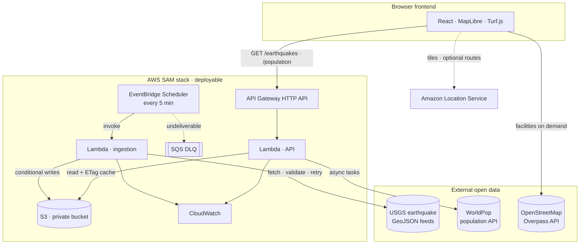

# GeoRescue: Building a Disaster Intelligence Platform with AWS and Geospatial Data

*How I combined live earthquake data, OpenStreetMap infrastructure and WorldPop population estimates on a serverless AWS pipeline to surface potential emergency response gaps.*

**Links:** [GitHub repository](https://github.com/TanseerS/GeoRescue-Mapping-Disaster-Impact-and-Emergency-Response-Gaps) · Live application: **[LIVE APP URL — add after deployment]** · Demo video: **[DEMO VIDEO URL — add after recording]**

[IMAGE 1: GeoRescue dashboard screenshot]

*Caption: GeoRescue's interactive disaster intelligence dashboard. A selected earthquake shows analysis rings, nearby mapped facilities and a generated intelligence brief.*

*Image source: Capture directly from the running GeoRescue application (`docs/screenshots/earthquake-details.png`; see the image guide, IMAGE 1).*

---

## 1. Introduction: why mapping disasters isn't enough

Almost every earthquake dashboard answers the same question: *where did it happen?* You get dots on a map, sized by magnitude, maybe colored by depth. That's useful, but it isn't the question responders and analysts ask next. They want to know **what's around the epicenter**:

- How far is the nearest hospital?
- How many fire and ambulance stations are within reach?
- How many people live nearby?

GeoRescue answers those follow-up questions in seconds, using open data and a serverless AWS backend. This article covers the architecture, the geospatial logic and the problems I hit along the way.

## 2. The problem: geographic emergency response gaps

A "response gap" here means something specific and deliberately modest: **an area where mapped emergency infrastructure is geographically far from an event relative to the people who live there.** An M5.8 earthquake 12 km from three hospitals is a very different situation from the same magnitude 60 km from the nearest one.

The data is public but split across three ecosystems with different formats, licenses and APIs. GeoRescue joins them on demand, the moment you click an epicenter.

## 3. Introducing GeoRescue

GeoRescue is a React and TypeScript single-page application backed by an AWS SAM stack. It lets you:

- **Explore live earthquakes** from USGS (the past 24 hours, 7 days or 30 days) as markers, clusters or a magnitude-weighted heatmap, colored by severity or focal depth.
- **Load emergency infrastructure** from OpenStreetMap around any epicenter: hospitals, clinics, fire stations, ambulance stations and police stations.
- **Run a configurable response gap analysis** with Turf.js: counts within three radii, the nearest hospital and fire station, and a coverage class.
- **Estimate population exposure** from the WorldPop gridded population dataset.
- **Optionally calculate driving routes** with Amazon Location Service.
- **Generate a deterministic intelligence brief** that can be copied into a report.

Throughout this article I distinguish clearly between what I've **verified locally** and what is **deployable but not yet deployed**. The SAM stack passes `sam validate --lint` and `sam build`, its logic is covered by unit tests, and the whole pipeline runs locally against live data. I haven't deployed it to an AWS account as of writing.

## 4. Architecture overview

[IMAGE 2: GeoRescue AWS architecture diagram]

*Caption: GeoRescue architecture. Solid orange nodes are created by the SAM stack; dashed nodes are optional; blue cylinders are external public data services.*

*Image source: Render of the project's Mermaid architecture diagram in the repository README (`docs/screenshots/architecture.png`; image guide, IMAGE 2).*



There are three tiers:

1. **External open data.** USGS feeds, the OpenStreetMap Overpass API and the WorldPop stats API.
2. **A serverless AWS pipeline.** EventBridge Scheduler, two Lambda functions, S3, an API Gateway HTTP API, CloudWatch and an SQS dead-letter queue, all defined in one `template.yaml`.
3. **A static frontend.** It renders with MapLibre GL JS and calls Amazon Location Service directly with a browser-safe API key.

A guiding principle: **the frontend works with zero configuration.** Without the API it reads USGS directly; without an Amazon Location key it uses an open basemap. The header always shows the active source.

## 5. Data sources

| Dataset | Access | Used for | License |
| --- | --- | --- | --- |
| **USGS earthquake feeds** | GeoJSON summary feeds (`all_day`, `all_week`, `all_month`) | Location, magnitude, depth, time, tsunami flag, PAGER alert | U.S. public domain |
| **OpenStreetMap** | Overpass API | Hospitals, clinics, fire, ambulance and police stations | © OpenStreetMap contributors, ODbL |
| **WorldPop** | Stats API, Global Population 2020 (unconstrained, ~100 m) | Residents inside circles around the epicenter | CC BY 4.0 |

One rule held across the codebase: **never fabricate data.** Earthquake records without a magnitude or coordinates are excluded, not estimated. A facility's details card shows only the OSM tags that actually exist. If a service fails, the UI shows a retry state, never placeholder numbers.

## 6. Building the interactive map: MapLibre and Amazon Location Service

The map uses **MapLibre GL JS 6**. For Amazon Location I used the **Maps API v2** with an API key, which needs no backend at all:

```ts
// src/services/mapStyle.ts (simplified)
const url = `https://maps.geo.${region}.amazonaws.com/v2/styles/${style}/descriptor?key=${apiKey}&color-scheme=Dark`;
```

Two details are worth knowing:

- **Least privilege for the key.** In the v2 Maps API, style descriptors, sprites and glyphs don't require authorization; tiles are the only gated call. So the key needs just `geo-maps:GetTile` on `arn:aws:geo-maps:<region>::provider/default`, plus referrer restrictions. The SAM template can create exactly that key.
- **An invalid key still returns a style.** I learned this by testing a deliberately bad key. The descriptor loads fine, then every tile returns HTTP 403 and the map goes blank. The fix was to treat tile 401/403 errors as a signal to switch to the open basemap, but only after the map is idle, because switching mid-request aborts in-flight sprite loads and produces noisy errors.

The selected epicenter gets a pulsing DOM marker, labeled dashed rings for each analysis radius, and a dotted line to the nearest mapped hospital.

## 7. Building the AWS serverless data pipeline

**EventBridge Scheduler** triggers the ingestion Lambda every five minutes. I chose Scheduler over a cron-style EventBridge rule for its built-in retry policy and dead-letter queue, which SAM wires up in a few lines:

```yaml
Events:
  IngestionSchedule:
    Type: ScheduleV2
    Properties:
      ScheduleExpression: rate(5 minutes)
      FlexibleTimeWindow: { Mode: "OFF" }
      RetryPolicy: { MaximumRetryAttempts: 2, MaximumEventAgeInSeconds: 240 }
      DeadLetterConfig: { Type: SQS }
```

The **ingestion Lambda** (Node.js 24 on arm64, bundled with esbuild) fetches `all_day` with timeouts and exponential-backoff retries, validates the payload, and keeps the original USGS properties. It writes four kinds of objects to a private **S3** bucket:

- `earthquakes/latest.geojson`
- a rolling 30-day window, seeded from `all_month` on the first run
- hourly snapshots under `earthquakes/history/YYYY/MM/DD/HH.json`
- `metadata/latest.json`

S3 is a deliberate choice over a database: the data is read-mostly, rewritten every few minutes and served whole or filtered by time.

The interesting problem is **concurrency.** Scheduler retries, async Lambda retries and manual invocations can overlap. I used **S3 conditional writes** as optimistic locking. The rolling window is written with `If-Match` on its ETag, and a conflict triggers a re-read and re-merge. History snapshots use `If-None-Match: *`, so the first snapshot of each hour is never overwritten:

```ts
// infrastructure/src/ingest/ingest.ts (simplified)
const current = await readJson(store, KEYS.window);
const result = mergeWindow(current?.value.features ?? seed, incoming, options);
try {
  await store.put(KEYS.window, body, current ? { ifMatch: current.etag } : { ifNoneMatch: "*" });
} catch (err) {
  if (err instanceof PreconditionFailedError) { /* another run won: re-read and re-merge */ }
}
```

The merge is idempotent. It also drops events that disappear from the 24-hour feed, which is how USGS deletions show up, and it expires events older than the window. Runs that see an already-ingested feed generation are skipped without writing anything.

The **API Lambda** sits behind an **API Gateway HTTP API**, chosen over a REST API for its lower price and built-in CORS. It serves `/earthquakes` (filtered by range, `since`, minimum magnitude and limit), `/earthquakes/metadata`, `/health`, and the population routes. Two optimizations matter:

- **ETag caching.** Warm Lambdas cache S3 objects and revalidate them with conditional GETs, so most requests transfer nothing from S3.
- **Gzip.** The 30-day window (about 9,900 events) is roughly 880 KB gzipped. Uncompressed, it would exceed Lambda's 6 MB response limit, so the API returns a clear 413 to clients that don't accept gzip.

Both Lambdas write **structured JSON logs** to CloudWatch (one object per line, queryable with Logs Insights), and API Gateway writes JSON access logs, all with a 14-day retention. An alarm fires when ingestion fails in 2 of 3 five-minute periods, and can optionally email you through SNS.

## 8. Earthquake intelligence

[IMAGE 3: Global earthquake map with clusters]

*Caption: A week of live USGS earthquakes, clustered and colored by the strongest event in each cluster.*

*Image source: Capture from the GeoRescue application, Overview in Clusters mode (`docs/screenshots/overview.png`; image guide, IMAGE 3).*

MapLibre handles about 1,800 weekly events (and about 9,900 monthly) comfortably, but the three display modes need different source configurations. I keep **two GeoJSON sources**: a plain one for markers and the heatmap, and a clustered one with `clusterProperties` that aggregates the maximum magnitude and summed depth. The clustered source is refreshed only while clusters mode is active, and switching modes toggles layer visibility rather than re-adding layers.

[IMAGE 4: Magnitude-weighted earthquake heatmap]

*Caption: The heatmap weights each event by magnitude, so large earthquakes aren't drowned out by swarms of micro-quakes.*

*Image source: Capture from the GeoRescue application in Heatmap mode (`docs/screenshots/heatmap.png`; image guide, IMAGE 4).*

The heatmap is a **magnitude-weighted kernel density**:

```ts
"heatmap-weight": ["interpolate", ["linear"], ["get", "mag"], 0, 0.04, 2, 0.12, 4, 0.4, 6, 1],
```

Depth coloring uses the standard seismological classes: shallow (0–70 km), intermediate (70–300 km) and deep (over 300 km). I validated the severity, depth and facility palettes for color-vision-deficiency separation and contrast against the dark basemap with a script, rather than eyeballing them. The overview panel adds magnitude categories, a depth histogram, activity over time, and the most active regions. Clicking a region zooms the map to it, which needed special handling for Aleutian events that straddle the 180° meridian.

## 9. Emergency infrastructure mapping

[IMAGE 5: Selected earthquake with nearby emergency infrastructure]

*Caption: OpenStreetMap hospitals, clinics and emergency services around a selected epicenter, with a facility details card.*

*Image source: Capture from the GeoRescue application, Emergency Facilities view with a facility card (`docs/screenshots/facilities.png`; image guide, IMAGE 5).*

When you select an earthquake, GeoRescue issues one Overpass query for everything within 50 km:

```
nwr["amenity"~"^(hospital|clinic|fire_station|police)$"](around:50000,lat,lon);
nwr["healthcare"~"^(hospital|clinic)$"](around:50000,lat,lon);
nwr["emergency"="ambulance_station"](around:50000,lat,lon);
```

Each type gets its own map icon and layer toggle. Clicking a facility opens a card with its verbatim OSM tags and its straight-line distance to the epicenter.

## 10. Response gap analysis

[IMAGE 6: Response gap analysis with configurable radii]

*Caption: Configurable radii drive the per-type facility counts, the map rings and the coverage classification.*

*Image source: Capture from the GeoRescue application, Response Gap Analysis (`docs/screenshots/gap-analysis.png`; image guide, IMAGE 6).*

The analysis is intentionally simple and transparent. **Turf.js** computes the great-circle distance from the epicenter to every facility. GeoRescue counts each type within three radii, finds the nearest hospital and fire station, and classifies coverage by the distance to the nearest mapped hospital:

```ts
export function rateProximity(nearestHospitalKm: number | null, radii = [10, 25, 50]): ProximityRating {
  const [inner, middle, outer] = radii;
  if (nearestHospitalKm === null || nearestHospitalKm > outer) return "critical";
  if (nearestHospitalKm <= inner) return "good";
  if (nearestHospitalKm <= middle) return "moderate";
  return "limited";
}
```

Fixed thresholds would be wrong somewhere: 25 km is far in a city and close in rural terrain. So the radii are configurable, with Urban (5/10/20 km), Standard (10/25/50 km) and Rural (20/35/50 km) presets, and the rings, table and classification update instantly. Labels stay honest: *"Potential coverage gap: no mapped hospital within 50 km"*, never *"response time exceeded"*.

## 11. Population exposure

[IMAGE 7: WorldPop population exposure estimates]

*Caption: Estimated residents within each analysis radius, from WorldPop's 2020 ~100 m gridded population dataset.*

*Image source: Capture from the GeoRescue application, population exposure section (`docs/screenshots/population-exposure.png`; image guide, IMAGE 7).*

WorldPop's stats API returns the total population inside any GeoJSON polygon, which is exactly what I needed. But it came with two problems:

1. **No CORS headers**, so browsers can't call it. Its responses are also prefixed with PHP deprecation notices.
2. **Synchronous calls took 18–23 seconds** in my tests, dangerously close to API Gateway's 30-second integration limit.

The solution was to route it through the API Lambda using WorldPop's **asynchronous task mode**, behind a stateless two-step contract:

```
GET /population?lat=…&lon=…&radii=10,25,50        → 202 {"status":"pending","tasks":[…]}
GET /population/tasks?lat=…&lon=…&radii=…&ids=…   → 202 while running, then 200 {"results":[…]}
```

The Lambda builds a 48-vertex geodesic circle per radius, submits the tasks in parallel, extracts the JSON from the noisy response body, validates task IDs as UUIDs before they reach an outbound URL, and caches results. The browser polls every few seconds. Because the contract is stateless, any Lambda instance can answer any poll. Results are rounded to three significant figures and labeled as **estimated residents, not casualties**.

## 12. Optional routing with Amazon Location Service

Straight-line distance is a proxy, and the UI never pretends otherwise. For a road-network comparison, GeoRescue can call the **Amazon Location Routes API v2** (`POST https://routes.geo.<region>.amazonaws.com/v2/routes?key=…`, `TravelMode: "Car"`, `LegGeometryFormat: "Simple"`) to draw a route from a facility to the epicenter, with road distance and estimated drive time.

It's opt-in: the key needs `geo-routes:CalculateRoutes`, which the SAM template adds only when `EnableMapRouting=true`. Routing is unit-tested and browser-tested against the documented response format, but not yet against a live key.

## 13. Challenges and how I solved them

- **Unreliable public APIs.** Overpass mirrors returned 502s, 504s and 30–60 second responses. I added *hedged requests* (start the next mirror after 8 seconds, keep the first success, cancel the rest) plus a 24-hour local cache.
- **MapLibre 6's worker URL.** After upgrading MapLibre to fix an XSS advisory, the map rendered blank. Version 6 resolves its web worker relative to its own module URL, which bundling breaks. The fix was `maplibregl.setWorkerUrl()` with a Vite asset URL, and emitting the worker as `.js` so any static host serves the right MIME type.
- **The WorldPop 30-second ceiling.** Solved with the async task contract described above.
- **Least privilege beyond the defaults.** SAM attaches `AWSLambdaBasicExecutionRole`, which allows writing to *any* log group. I replaced it with explicit roles that can write only to each function's own log group.

## 14. Security, reliability and cost

**Security**

- **IAM.** Roles are scoped to the `earthquakes/*` and `metadata/*` prefixes, and the API role is read-only.
- **S3.** Block Public Access is on, ACLs are disabled, data is encrypted with SSE-S3, and the bucket policy is TLS-only.
- **API exposure.** An explicit CORS allow-list, GET-only routes, stage throttling at 20 req/s, and tighter per-route throttles on the WorldPop-backed endpoints.
- **Validation and errors.** Input is validated, error bodies are generic, and no credentials exist anywhere: Lambdas use execution roles, and the browser holds only a restricted Amazon Location key.

[IMAGE 8: GeoRescue data pipeline status in the application]

*Caption: The About page's pipeline card reads live ingestion status from `GET /earthquakes/metadata` (shown here against the local pipeline).*

*Image source: Capture from the GeoRescue application's About page against the local pipeline (`docs/screenshots/pipeline-status.png`; image guide, IMAGE 8).*

**Reliability**

Fetch retries, the scheduler's dead-letter queue, conditional writes, a `/health` endpoint that returns 503 when data is stale, and an automatic USGS fallback in the browser.

**Cost**

There are no always-on resources (no VPC, NAT Gateway or database). Lambda's roughly 8,640 monthly runs and Scheduler fit within their free tiers, and S3, API Gateway and CloudWatch cost cents: an estimated well under $1 a month at demo traffic, from published pricing rather than a measured bill.

**Verification:** 41 frontend and 35 Lambda unit tests, `sam validate --lint`, a 35-check browser audit with simulated outages of every data source at four viewport sizes, and an axe-core WCAG A/AA scan with zero violations.

## 15. Limitations and responsible use

GeoRescue measures **geographic proximity, not response capability.** Facility capacity, staffing, damage, road conditions and real response times are unknown. OpenStreetMap coverage is uneven, so a "potential gap" may be a *mapping* gap. WorldPop figures are modelled 2020 residential estimates, not real-time or casualty data. It is a decision-support visualization, not a dispatch or alerting system, and the interface says so wherever results appear.

## 16. What I learned and what's next

- **Test against live services, not just docs.** The invalid-key behavior, MapLibre's worker resolution and WorldPop's latency only appeared that way.
- **Make honesty a feature.** Source badges, rounding and "not a casualty estimate" labels build trust.
- **Serverless fits read-mostly geospatial data.** S3 with conditional writes replaced a database.

Next on my list: deploying the stack and Amplify Hosting; drive-time isochrones instead of circles; USGS ShakeMap intensity weighting; additional hazards such as GDACS floods and NASA FIRMS wildfires; and batch ranking of events by exposed population per kilometre to the nearest hospital.

## 17. Conclusion

GeoRescue doesn't just visualize disasters. It combines disaster locations, emergency infrastructure and population exposure to reveal **potential geographic response gaps**, from open data. The AWS footprint is deliberately small; most of the effort went into making unreliable public data dependable and every number explainable.

## 18. GitHub repository and project links

[IMAGE 9: GeoRescue GitHub repository]

*Caption: The public GeoRescue repository, with the application, the AWS SAM infrastructure and the deployment guide.*

*Image source: Capture of https://github.com/TanseerS/GeoRescue-Mapping-Disaster-Impact-and-Emergency-Response-Gaps (image guide, IMAGE 9).*

- **Source code:** https://github.com/TanseerS/GeoRescue-Mapping-Disaster-Impact-and-Emergency-Response-Gaps
- **Deployment guide:** [docs/DEPLOYMENT.md](https://github.com/TanseerS/GeoRescue-Mapping-Disaster-Impact-and-Emergency-Response-Gaps/blob/main/docs/DEPLOYMENT.md)
- **Live application:** [LIVE APP URL — add after deployment]
- **Demo video:** [DEMO VIDEO URL — add after recording]

*Data attribution: earthquake data courtesy of the U.S. Geological Survey. Facility data © OpenStreetMap contributors (ODbL). Population data © WorldPop (CC BY 4.0). Basemap © CARTO / OpenStreetMap contributors, or © AWS / HERE via Amazon Location Service.*
